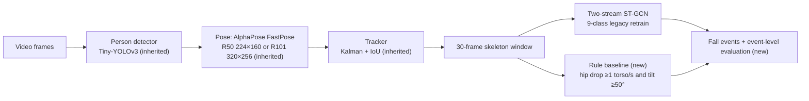

# Fall detection: evaluating an inherited skeleton-based system

This is an **evaluation and engineering extension of an existing system**, not a new detector.

I inherited a student fall-detection project built on [GajuuzZ/Human-Falling-Detect-Tracks](https://github.com/GajuuzZ/Human-Falling-Detect-Tracks):
- Tiny-YOLOv3 → AlphaPose FastPose → tracker → ST-GCN;
- a retrained 9-class ST-GCN;
- a claimed 97.8% accuracy.

The goal was to find out how well it actually detects falls, honestly measured:
- I recovered a runnable, tested pipeline;
- traced what the model had trained on;
- built an event-level evaluation;
- compared it against a simple rule baseline;
- ran a small labelled pilot on scenes the model never saw.

> **Status: research prototype.**
> - The results below come from **96 falls on scenes the model trained on** and a **10-video, 5-fall pilot** on unseen scenes.
> - The pilot labels were human-accepted model-free proposals, reviewed quickly.
> - Nothing here supports a production accuracy claim, or a claim that one detector is statistically better than another.

## Pipeline



## What is mine and what is inherited

| Inherited, not in this repo | Added here |
|---|---|
| Detector, pose model, tracker and ST-GCN code (GajuuzZ, which builds on AlphaPose, ST-GCN, deep_sort and PyTorch-YOLOv3) | `src/fall_detection/`: a clean CPU pipeline around the inherited models, with explicit config, versioned outputs and tests |
| Model weights (GajuuzZ release), and the 9-class ST-GCN retrained by the original student team | Reproducible keypoint extraction (`data/extract.py`), Le2i inventory and parsing (`data/le2i.py`) |
| Le2i dataset (dataUBFC) | Training-lineage reconstruction: which Le2i videos the legacy model saw (`scripts/map_legacy_segments.py`) |
| | Rule baseline (`baselines/rule.py`) and event-level metrics (`evaluation/events.py`) |
| | Annotation-pilot tooling: blind proposal workflow, review tool, validation (`scripts/annotate_falls.py`, `check_annotations.py`) |
| | Reports: `reports/l1/`, `reports/pilot/`, `docs/` |

The forensic background (training-data leakage behind the 97.8%, pose-model mismatch, confounded classes) is summarised in [docs/PROJECT_HISTORY.md](docs/PROJECT_HISTORY.md).

## Data and evaluation

**Dataset.** Le2i Fall Detection Dataset, official dataUBFC release ([doi:10.25666/DATAUBFC-2024-04-09](https://doi.org/10.25666/DATAUBFC-2024-04-09), CC BY-NC-SA 3.0).
- 190 videos, 320×240.
- Coffee room and Home have official annotations.
- Lecture room and Office have none.

**Events.**
- Per-frame "Fall Down" predictions are merged into events (2 s gap).
- A prediction counts as a detection if it starts within [fall start − 1 s, fall end + 3 s].
- Extra predictions are false alarms, reported per hour of non-fall video.

**Two evaluations:**
- **L1: 127 annotated videos, 96 falls, 19.4 min non-fall.** The legacy model trained on almost all of these videos (only 1 annotated video is unseen). This is effectively a training-set measurement. Details in [reports/l1/L1_REPORT.md](reports/l1/L1_REPORT.md).
- **Pilot: 10 unseen videos (5 Lecture room, 5 Office), 5 falls, 4.24 min non-fall.**
  - The videos were chosen with a fixed seed from the inventory only.
  - Fall proposals came from visual inspection by a vision-language model, blind to all detector outputs.
  - A human then reviewed every proposal and accepted all 10 unchanged, in 59 s total.
  - So the labels are **human-accepted proposals, not independent annotations.**
  - Details in [reports/pilot/PILOT_EVAL_REPORT.md](reports/pilot/PILOT_EVAL_REPORT.md) and [PILOT_PROPOSAL_REPORT.md](reports/pilot/PILOT_PROPOSAL_REPORT.md).

## Results

| Detector | L1 recall (seen scenes) | L1 false alarms | Pilot recall (unseen) | Pilot 95% CI | Pilot false alarms |
|---|---|---|---|---|---|
| Rule baseline (R50 pose) | 0.69 (66/96) | 0 | 0.60 (3/5) | 0.15–0.95 | 0 |
| Legacy ST-GCN, R50 pose (as deployed) | 0.90 (86/96) | 3 (9.3 / h) | 1.00 (5/5) | 0.48–1.00 | 1 (14 / h) |
| Legacy ST-GCN, R101 pose (as trained) | 0.92 (88/96) | 1 (3.1 / h) | 0.60 (3/5) | 0.15–0.95 | 1 (14 / h) |

**Reading these numbers:**
- **On the pilot, every confidence interval overlaps.** The pilot cannot rank the detectors.
- **The L1 advantage of R101 did not carry over** to unseen scenes. But that is a point estimate on 5 falls.
- **The detectors fail on different falls.** Only 1 of the 5 pilot falls was detected by all three.
- **The rule has no false alarms in either set.** It misses slow falls and falls seen from above.

### Failure examples (pilot)

| Error | Evidence | Cause |
|---|---|---|
| R101 misses `office/3` | Pose kept in 30% of the fall window's frames (R50: 100%), so the track broke | pose/tracking |
| R101 misses `lecture_room/2` | Slow slumping collapse labelled "Lying Down"; highest Fall score 0.22 (R50: 0.82) | classifier, on a medium-confidence label |
| Rule misses `lecture_room/11` | Hip drop 0.9 torso lengths per second, tilt 29° (thresholds 1.0 and 50°) | threshold; slow kneel-then-collapse |
| Rule misses `office/9` | Backward fall seen from above: only 0.47 torso lengths of 2D drop | rule geometry |
| R50 false alarm, `lecture_room/26` | Person bends at a table handling a bag | bending mistaken for a fall |
| R101 false alarm, `office/30` | Person sits down at a desk | sitting down mistaken for a fall |

## Limitations

- **Tiny pilot.**
  - 10 videos and 5 falls.
  - False-alarm rates rest on 0–1 events in about 4 minutes.
  - Only two rooms.
- **Label quality.**
  - The pilot labels started as one model's proposals and were accepted faster than they could be played back, so confirmation bias is likely.
  - Blind calibration of the proposal method covered 9 videos, only **2 of them no-fall**. No-fall calls are therefore barely calibrated, yet they make up half the pilot.
  - The changed end-of-fall convention was not re-tested blind.
- **The L1 numbers are near-training-set numbers.** Don't read them as generalisation.
- **Confounded classes in the legacy model:** see `docs/PROJECT_HISTORY.md`. No model was retrained.
- **Not fully reproducible from this repository alone:**
  - the 9-class model behind every reported number is private;
  - the Le2i videos must be downloaded separately;
  - the inherited code is fetched from upstream at run time.

## Setup (macOS / Linux, CPU, Python 3.10)

Tested on macOS (Apple silicon). Linux is expected to work with the same pinned wheels. Windows is not tested.

```bash
python3.10 -m venv .venv && .venv/bin/pip install -e ".[dev]"
.venv/bin/python scripts/fetch_third_party.py
.venv/bin/python -m pytest
```

`fetch_third_party.py` clones the upstream repository at a pinned commit. It then checks all 38 files against recorded hashes and applies a small CPU-loading patch. The package imports this code, so it is required for everything, including the tests (`pytest` stops with a message if it is missing).

Without model weights, the tests that need models are skipped. The rest of the suite (34 tests) covers:
- event metrics;
- the annotation format and the review tool;
- feature normalisation;
- output schema.

**Model weights** (not included):
1. Download the files listed in [models/MANIFEST.tsv](models/MANIFEST.tsv) from the upstream author's links.
2. Run:

```bash
.venv/bin/python scripts/setup_models.py --search ~/Downloads --include-optional
.venv/bin/python scripts/run_video.py path/to/video.avi --config configs/upstream_7class.yaml
```

The public 7-class upstream ST-GCN (`configs/upstream_7class.yaml`) runs the same pipeline. It is **not** the model evaluated above, so its results will differ.

**Reproducing the evaluations** needs:
- the Le2i release (download it from the DOI above);
- `scripts/le2i_inventory.py`, then `extract_dataset.py`, then `eval_l1.py` / `eval_pilot.py`;
- the private 9-class checkpoint.

`map_legacy_segments.py` additionally needs the private legacy training pickles. The reports record the exact extraction settings (`reports/l1/extractors.json`).

## Repository layout

```
src/fall_detection/   pipeline, features, rule baseline, evaluation, annotation format
scripts/              CLI entry points (run, extract, evaluate, annotate, fetch upstream code, set up models)
configs/              legacy_baseline (R50), legacy_r101, upstream_7class
annotations/le2i_pilot/  pilot selection, proposals, human-reviewed labels (CC BY-NC-SA)
reports/              L1 and pilot reports with their CSV/JSON artefacts
docs/                 baseline notes, dataset notes, evaluation plan, backlog, project history
third_party/          upstream file list, hashes and CPU patch (the code itself is fetched)
```

## Attribution and licensing

- **Pipeline design, code and weights:** GajuuzZ/Human-Falling-Detect-Tracks, building on AlphaPose, ST-GCN (Yan et al., 2018), deep_sort and PyTorch-YOLOv3.
- **Dataset:** Le2i / ImViA, Université de Bourgogne (dataUBFC).
- **Original code here:** MIT ([LICENSE](LICENSE)).
- **Annotations and reports:** CC BY-NC-SA 3.0, derived from Le2i.
- **Upstream code:** declares no licence and is **not** redistributed. Combining it with GPL-3.0 parts has consequences for distribution: see [THIRD_PARTY_NOTICES.md](THIRD_PARTY_NOTICES.md).
